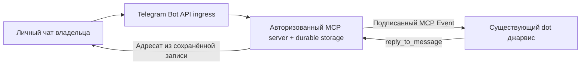

# Telegram → существующий dot «джарвис»: исследование и план стенда

Дата проверки: 2026-10-29. Статус: исследование; сквозной roundtrip не выполнен.

## Цель и границы

Доставлять личные Telegram-сообщения владельца существующему dot и возвращать
ответ этого dot в тот же чат. Отдельная API-модель не подменяет dot.
Сначала проверяется текст; голосовые заметки и звонки — отдельный этап.

Разрешены подготовка без секретов и локальные offline-тесты. Пока запрещены
push/PR, публичный запуск, изменения действующих серверов, создание постоянных
credentials, внешние подписки и отправка сообщений в Telegram. Секреты вводятся
в защищённых настройках только после конкретного разрешения, никогда в чате.

Репозиторий при исследовании пуст, HEAD не содержит коммитов; локальные
`.agents` пусты, executor skills не обнаружены. Прототип готовится отдельно
и должен появиться в этой среде; его реализацию до получения не дублируем.

## Подтверждено официальными источниками

1. [MCP Events](https://developers.openai.com/plugins/build/mcp-events):
   поддерживаются dots, Work web и Work/Cloud desktop. Событие приходит именно
   в подписанный чат. Требуются MCP 2.0 / `2026-07-28`, `server/discover`
   с `capabilities.events`, методы `events/list`, `events/subscribe`,
   `events/unsubscribe` на том же авторизованном endpoint, что и tools.
   Поддерживается webhook с проверкой callback; polling/streaming доставки
   событий этим интеграционным механизмом не поддерживаются.
2. [Auth](https://developers.openai.com/plugins/build/auth): OAuth 2.1,
   authorization code + PKCE S256, protected-resource metadata и discovery.
   CIMD предпочтителен при поддержке провайдером; DCR также поддерживается.
   Сервер проверяет подпись токена, issuer, audience/resource, exp/nbf и scopes
   на каждом запросе. Идентичность профиля должна переживать refresh/reconnect.
   Произвольный статический API key не заменяет поддерживаемую авторизацию.
3. [Подключение и тестирование](https://developers.openai.com/plugins/deploy/connect-chatgpt):
   возможны public HTTPS или Secure MCP Tunnel, с учётом политик workspace.
   Наличие tunnel в документации не доказывает доступность Events с ним в
   конкретном аккаунте. Нужен отдельный разрешённый тест в существующем dot.
4. [phone.acceptCall](https://core.telegram.org/method/phone.acceptCall):
   `Only users can use this method`. Bot API не даёт боту принять обычный
   Telegram-звонок. WebRTC с отдельной моделью не является голосом этого dot.

## Кандидат архитектуры

Это event-triggered workflow, не встроенный Telegram-канал ChatGPT.
Само существование документации не подтверждает entitlement аккаунта,
разрешение workspace, сохранение контекста нужного dot или успешный roundtrip.

## Контракты безопасности

- Подтверждённая сервером привязка authenticated principal ↔ numeric `from.id`
  ↔ private `chat.id`. Username не участвует в авторизации. Процедуру связывания
  проверить отдельно; подстановка ID в конфиг без подтверждения не достаточна.
- Допускается только привязанный владелец и личный чат; группы, каналы,
  пересылки как команды, сообщения других пользователей отклоняются.
  Редактирования, business updates и прочие неподдержанные виды — fail closed.
- Tool `reply_to_message(message_ref, text, idempotency_key)` не принимает
  адресата. Непрозрачный message_ref разрешается на сервере с проверкой
  principal, актуальной привязки, срока жизни и отзыва доступа.
- Event payload — недоверенные данные. Текст не меняет адресатов, инструменты,
  полномочия или правила dot. Пользователь задаёт правила отдельно в dot.
- Хранить ingress dedup, сообщения, подписки и outbox устойчиво и транзакционно.
  Повтор с тем же ключом и иным содержимым — конфликт; гонки и restart должны
  покрываться тестами. Не обещать exactly-once: сбой после принятия sendMessage
  Telegram, но до фиксации результата, оставляет неопределённый исход.
  Не повторять такую отправку вслепую; выделить состояние uncertain и процедуру
  разрешения, не допуская скрытого повторного сообщения.
- Два разных trust boundary: входящий Telegram webhook проверяет
  `X-Telegram-Bot-Api-Secret-Token`; исходящий MCP webhook использует
  Standard Webhooks. Telegram secret header не является подписью тела.
- MCP подписка: owner authorization, canonical JSON identity, signing secret
  `whsec_` с decoded длиной 24–64 bytes, конечный TTL по умолчанию, durable
  state, идемпотентные refresh/unsubscribe, отзыв доступа и остановка доставки
  после expiration. Replay/cursor объявлять только при реальной реализации.
- Перед доставкой — fresh single-use short-lived challenge; подписанный запрос,
  2xx и constant-time comparison echo. Не активировать при ошибке.
- Callback только HTTPS; запрет private/local/non-public IP, credentials в URL
  и redirects. Проверка DNS на каждом соединении и подключение именно к
  проверенному адресу с исходным hostname для TLS: одна предварительная
  проверка URL не защищает от rebinding. Это относится и к challenge, и к retry.
- Standard Webhooks подписывает точные отправляемые bytes. `webhook-id` равен
  `eventId`; ID сохраняется при retry, timestamp/signature обновляются.
  Bounded backoff, без retry для 410/413; отдельно обработать отзыв и ротацию.
- Не логировать токены, callback signing secrets, Authorization, Telegram URL
  с bot token, полные payload и персональные данные. Установить retention,
  ограничение размера входа и текста, rate limits и защиту от feedback loop.

## Проверяемый план после получения прототипа

1. Найти переданный артефакт, прочитать README/manifest, состав файлов и тесты;
   проверить отсутствие секретов и реальных сетевых действий. Зафиксировать
   происхождение и зависимости, не исполняя непроверенные install hooks.
2. Сопоставить реализованные контракты с этим документом. Интегрировать только
   полезные компоненты без перезаписи существующих файлов и без изменения
   удалённого репозитория. Конфликты имен разрешать явно.
3. В изолированном offline-режиме выполнить реальный runner и записать число
   passed/failed/skipped; результаты mock не выдавать за интеграцию с dot.
4. Положительный тест: synthetic private update → durable event → mock callback
   verification/delivery → mock tool reply → mock Telegram transport. Ровно
   ожидаемые локальные записи, верный message_ref, исходный личный адресат.
5. Отрицательные тесты: чужой principal/from/chat, username spoofing, группы,
   forwarded messages, несуществующий/чужой/истёкший ref, отзыв и payload injection.
6. Устойчивость: duplicate update/event/tool call, конфликт idempotency payload,
   concurrent calls, restart, expiration, refresh/rotation, unsubscribe,
   timeout/410/413, uncertain send outcome, отсутствие feedback loop.
7. Callback: bad signature, stale timestamp/replay, failed/reused challenge,
   HTTP/private IPv4/IPv6/mapped IP, mixed DNS, rebinding, redirect, неверный TLS.
   Fake transport проверяет логику, но реальную защиту DNS/TLS подтверждает
   отдельный тест фактического transport до допуска внешних событий.
8. Сохранить воспроизводимые offline install/start/check команды, только когда
   они проверены на полученном коде. Записать незакрытые auth/transport gaps.

## Минимальный следующий внешний этап — только после разрешения

Сначала подтвердить наличие custom MCP/Events у нужного dot и выбрать OAuth
провайдера и endpoint/tunnel. Затем отдельно согласовать deployment, защищённую
передачу credentials, связывание владельца, создание одной подписки и отправку
одного тестового сообщения в личный чат. Проверить доставку именно существующему
dot, его tool call, ответ в тот же чат, затем unsubscribe и прекращение доставки.
До этого сквозной текстовый канал и тем более звонки не считаются работающими.
